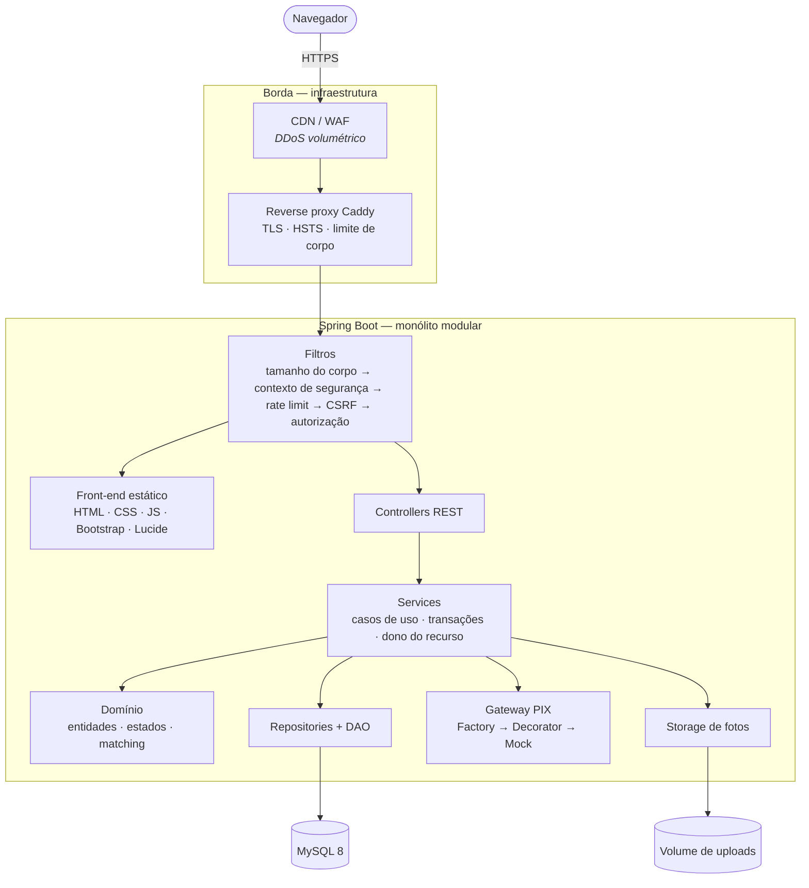
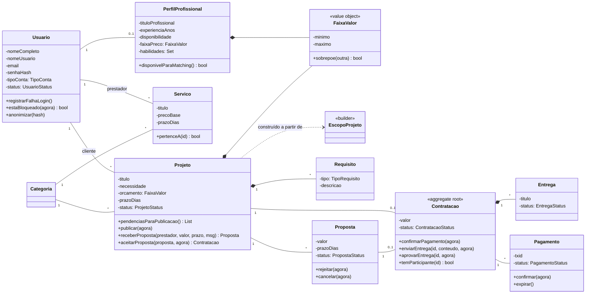
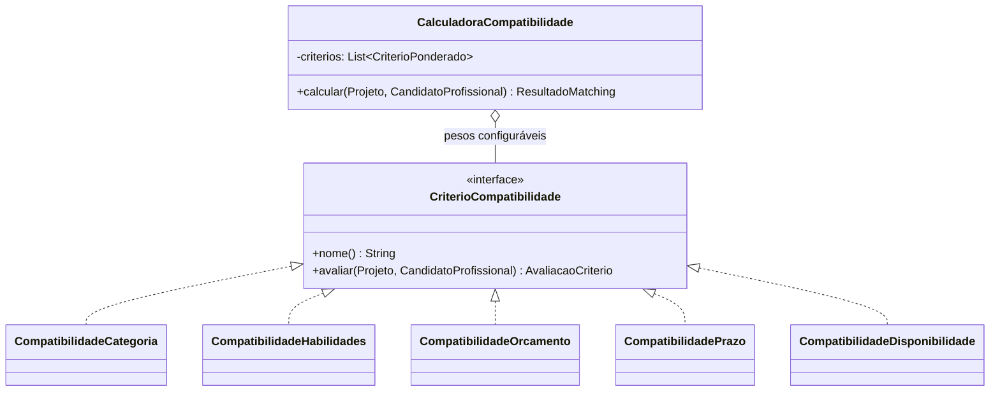
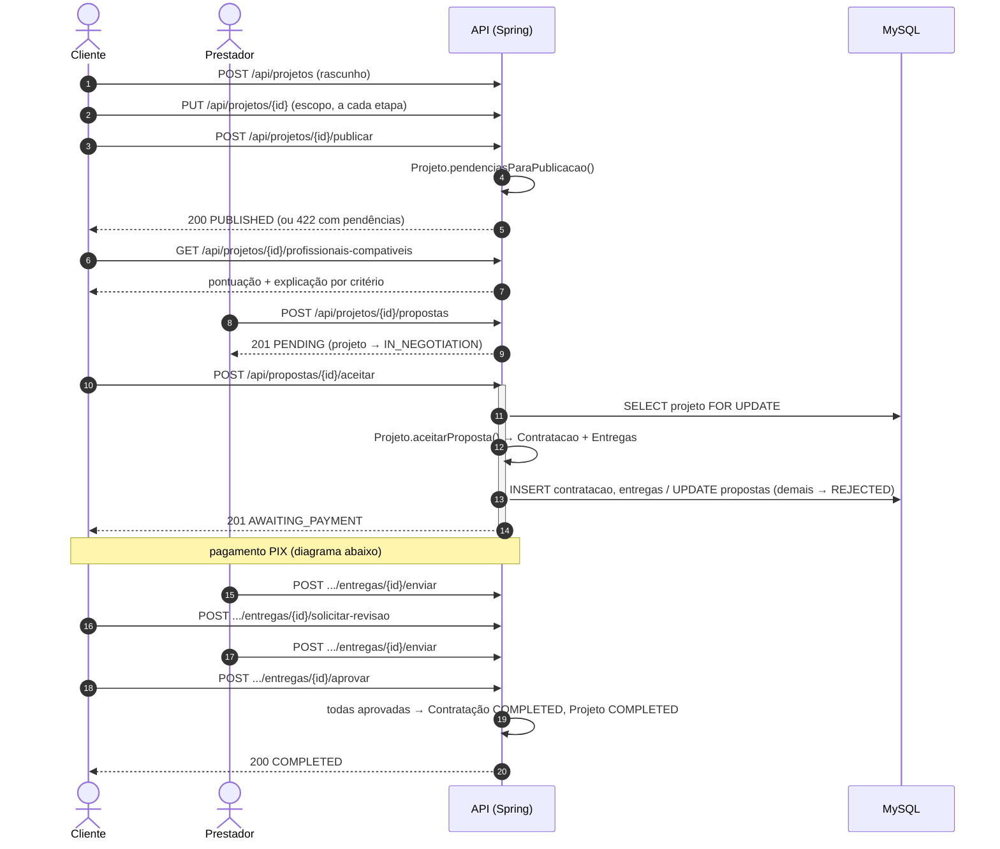
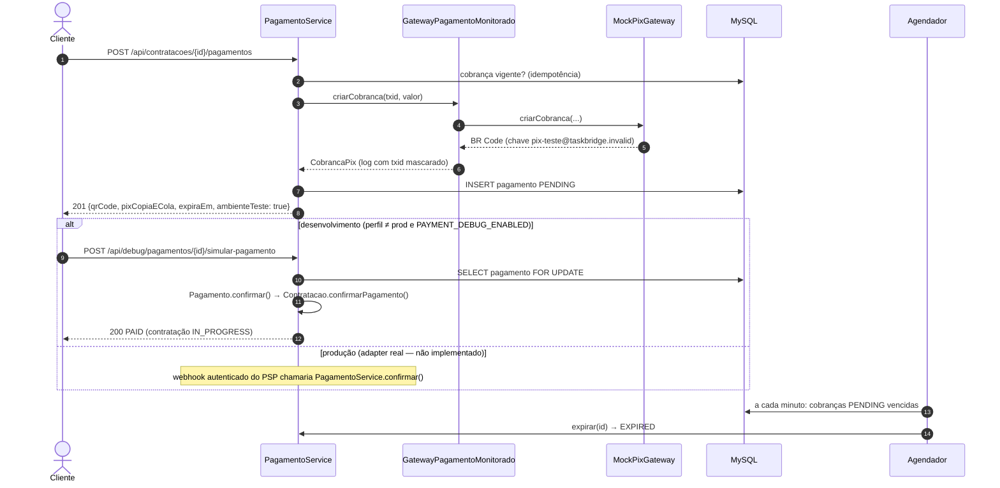
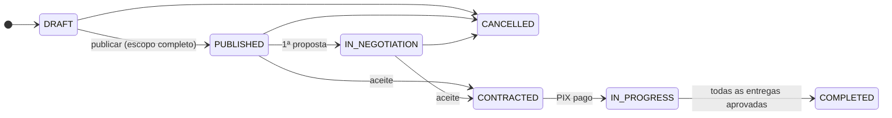
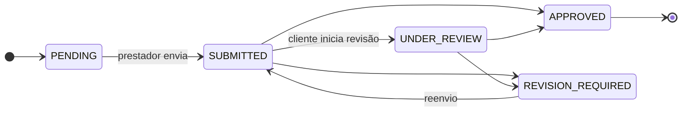

# Diagramas

Todos em Mermaid (renderizam direto no GitHub).

## Arquitetura

## Classes do domínio

## Strategy do matching

## Sequência — fluxo principal

## Sequência — PIX mock

## Estados

